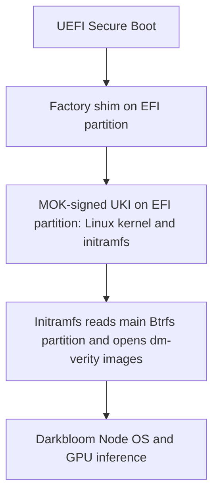
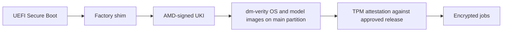

# Run the Darkbloom text demo on AMD Halo

Boot a signed inference appliance on your Halo, verify it from a mock coordinator
on a Mac using AMD Pluton TPM evidence, send an encrypted text prompt to the
Radeon GPU, and decrypt the response with a verified receipt.

**Start with the [fresh Halo setup guide](RUNBOOK.md)** to enroll a boot key,
run encrypted inference through a Mac mock coordinator, and add Darkbloom
to the firmware boot picker with AMD Linux as the default. The guide follows
the reference lab's one-time shim boot before testing the firmware picker
on the new unit.

## Target owner setup and boot experience

The intended product starts with a Darkbloom setup wizard in the factory AMD OS.
It pairs the owner's account, checks hardware and storage, provisions network
and service credentials, installs approved signed boot files in the small EFI
space and verified OS/model images on the main partition, then queues a one-time
Darkbloom boot and reboots automatically. That OS establishes its own Ethernet
or provisioned Wi-Fi internet connection and authenticates to the real Darkbloom
coordinator over TLS. It receives
prompts only after fresh TPM attestation matches an approved release. On later
power-ons, the factory boot manager offers AMD OS and Darkbloom OS as choices.

The reproduction guide uses manual MOK enrollment, the firmware boot picker,
and a mock coordinator on the local network. The [TPM-sealed Wi-Fi and
desktop wizard](tools/halo-e2e/WIZARD-TEST.md) and [signed model
catalog](tools/halo-e2e/MODEL-CATALOG.md) are opt-in previews with hardware
acceptance pending. AMD signing and real-coordinator onboarding remain
integration work.

## Boot layout and the 110 MB EFI budget

The demo keeps a small signed boot payload on the EFI System Partition (ESP).
The large OS/runtime and model images live on the main Linux Btrfs partition.
The signed boot payload starts Darkbloom's OS directly and verifies those images
before using their contents.



Measured EFI files from the demo's sealed boot:

| EFI component | Bytes | MB (decimal) |
| --- | ---: | ---: |
| Signed UKI, including kernel and initramfs | 23,625,712 | 23.626 |
| Factory shim | 1,036,152 | 1.036 |
| MokManager enrollment utility | 873,904 | 0.874 |
| **Total per installed demo version** | **25,535,768** | **25.536** |

Taking the discussed **110 MB as the space budget available for Darkbloom's
boot files (110,000,000 bytes)**, this leaves approximately **84.46 MB**.
The installer also requires a **16 MiB free-space margin**; the
payload plus that margin needs approximately **42.31 MB**, within the budget.
These figures cover one demo version in addition to the existing factory boot
files. Retaining multiple versions consumes additional ESP space.

In the measured pinned-model demo, the following larger files stay on the main partition under
`/var/lib/darkbloom-text-nodeos/<id>/` and do not consume the EFI budget:

| Main-partition file | Measured size |
| --- | ---: |
| `root.erofs` — OS, ROCm and inference runtime | 9.394 GB |
| `models.erofs` — model image | 18.557 GB |
| `root.verity` — OS verification tree | 73.982 MB |
| `models.verity` — model verification tree | 146.133 MB |

The UKI embeds the partition identifiers, image paths and dm-verity root hashes
in its signed command line. Its initramfs mounts the selected Btrfs filesystem
read-only, opens the verified images and starts Node OS with a RAM overlay.
The coordinator checks the resulting TPM boot measurements against the approved
release. Sharing the owner's disk partition provides storage; the owner's normal
Linux OS is not running during this boot.

Sizes are a measured example, not a maximum for future builds. The
[installer](nodeos/text/install.sh) checks actual free ESP space before writing;
the [image build](nodeos/text/build.sh) and [initramfs](nodeos/text/init) implement
the layout above.

## Proposed AMD-signed deployment

AMD signing could remove manual MOK enrollment **only if** the signing key is
already trusted by the factory shim or UEFI firmware. With the factory shim:



If firmware trusts the key in its `db`, it could load the UKI directly without
shim. That changes the measured PCR 4 boot chain and skips shim's MOK
measurements in PCR 14; the release builder and verifier would need a matching
profile.

This path is an integration proposal, not an implemented or tested mode. The
current bootstrap and installer require MOK, and the bundle installer verifies
its deployment manifest with the same boot certificate. AMD would need to sign
each changed or device-specific UKI. For installation, AMD must also sign its
deployment manifest or we must provision a separate trusted deployment key. The
fixed certificate checks, TPM reference measurements and coordinator release policy must then be
updated for the new chain. A boot signature authorizes boot; a separately
approved coordinator release authorizes jobs.

## Requirements

- A Ryzen AI Halo with Pluton TPM, Secure Boot enabled, a monitor and keyboard
  for MOK enrollment, and an ordinary Linux account with initial sudo access.
- The reference software profile: RAH-002 / Ryzen AI Max+ PRO 495 / gfx1151,
  vendor Rex kernel `7.2.7+rex-amd64`, Debian systemd `257.13-1~deb13u1`,
  the vendor RyAI package feeds, and rootless Podman on the Halo.
- The image store on Btrfs top-level subvolume 5. Other disk layouts need an
  installer/initrd adaptation. Configure your own partition identifiers.
- A trusted Mac with Rust 1.96.0, Python 3, OpenSSL and Docker. Keep boot and
  release signing private keys on the Mac.
- Both machines on a reachable LAN. Allow Halo connections to Mac TCP port
  8790 while keeping the firewall enabled.
- Storage for the 18.6 GB model, its verity image, rootfs builds and installation.

This is an attested encrypted inference demo. The serving kernel and GPU stack
remain trusted; the hardware does not provide SEV-SNP or a demonstrated GPU TEE.
Use synthetic prompts. Generate your own keys and collect your own measurements.

To check the source and installation interfaces before using hardware:

```bash
bash tools/repro/check.sh
```
